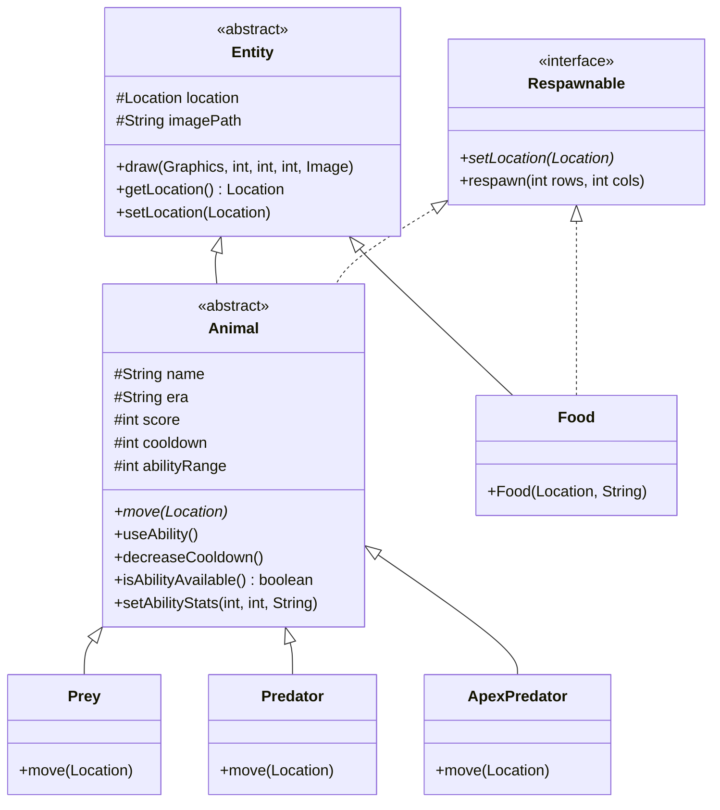

# Food Chain Through Time

[](https://www.oracle.com/java/)
[](https://docs.oracle.com/javase/8/docs/technotes/guides/swing/)
[](#software-architecture-and-oop-design)
[](LICENSE)

A turn-based ecological grid simulation and strategy application built with pure Java (Swing and AWT). Designed to demonstrate Object-Oriented Programming (OOP) principles, clean layered architecture, autonomous heuristic AI agents, dynamic rule configuration, and custom game state persistence.

---

## Project Overview

**Food Chain Through Time** simulates ecological food webs across three distinct eras: **The Past** (Prehistoric), **The Present** (Modern wildlife), and **The Future** (Cybernetic).

The simulation executes on a 2D coordinate grid where entities interact within a multi-agent hierarchy:
- **Apex Predator (AI):** The top-tier hunter pursuing both the Predator and Prey.
- **Predator (Player):** The intermediate carnivore responsible for hunting Prey while avoiding the Apex Predator.
- **Prey (AI):** An autonomous herbivore navigating towards Food while actively evading threats using multi-objective heuristic evaluation.
- **Food:** Stationary resource nodes consumed by Prey that regenerate at random positions upon consumption.

---

## Software Architecture and OOP Design

The codebase follows a modular, decoupled package structure adhering to separation of concerns:

```
src/
├── entities/       # Domain models, inheritance hierarchy, and spatial state
├── logic/          # Game engine, coordinate geometry, and heuristic AI
├── gui/            # Presentation layer (Swing rendering, CardLayout navigation)
├── io/             # File parsing, state serialization, and event logging
├── exceptions/     # Domain-specific checked exception hierarchy
└── assets/         # Sprites and era configuration datasets
```

### 1. Object-Oriented Programming Principles

| Principle | Implementation |
| :--- | :--- |
| **Abstraction** | • `abstract class Entity`: Abstract base class managing spatial coordinates (`Location`), sprite resource paths, and graphics rendering with fallback mechanisms.<br>• `abstract class Animal`: Extends `Entity` to abstract health status, cooldown timers, score tracking, and the abstract method `move(Location targetLoc)`.<br>• `interface Respawnable`: Decouples the capability to respawn across grid boundaries. |
| **Polymorphism** | • **Dynamic Method Dispatch:** The GUI layer renders heterogeneous entities (`Prey`, `Food`, `Predator`, `ApexPredator`) uniformly via polymorphic draw operations.<br>• **Collision Resolution:** Entity interactions (hunting, eating, damage calculation) are resolved dynamically at runtime based on entity types.<br>• **Generic Lookups:** Type-safe entity retrieval using Java Generics (`<T extends Entity> T getEntityByType(Class<T> type)`). |
| **Inheritance** | • Domain hierarchy: `Entity` &rarr; `Animal` &rarr; `Predator`, `Prey`, `ApexPredator`.<br>• Resource model: `Entity` &rarr; `Food`.<br>• Exception hierarchy: `Exception` &rarr; `GameException` &rarr; `FileOperationException`, `InvalidGameData`. |
| **Encapsulation** | • Spatial coordinate state is encapsulated in `Location`, providing Euclidean distance calculation (`distanceTo`) and equality validation.<br>• Animal state variables (scores, cooldown limits, ability parameters) are guarded by controlled accessors and mutators. |

### 2. Design Patterns and Technical Implementation

- **Strategy and Configuration Injection (`GameConfig`):** Animal attributes, ability ranges, and cooldowns are injected dynamically at initialization based on the active Era, decoupling rule configurations from domain entity definitions.
- **Interface Default Methods (`Respawnable`):** Provides a reusable default method for pseudorandom coordinate repositioning using `SecureRandom`.
- **Data Transfer Object (`LoadedGameFormat`):** Encapsulates configuration headers, grid dimensions, and reconstructed entity lists during file deserialization.
- **Defensive Design:** Initial entity positions are validated to prevent overlaps on startup, and file operations use domain-specific exceptions for safe failure recovery.

### 3. Class Hierarchy Diagram



---

## Autonomous AI Algorithms

AI agents execute heuristic decision-making on every turn rather than predefined scripted paths:

### 1. Prey AI (Multi-Objective Greedy Decision)
The Prey evaluates all candidate moves (standard steps and special ability steps) using a weighted utility function:

$$\text{Utility} = 2.0 \times \text{distanceTo}(\text{Threat}) - \text{distanceTo}(\text{ClosestFood})$$

The agent prioritizes evasion from the nearest threat (`Predator` or `ApexPredator`) while simultaneously minimizing the distance to food resources.

### 2. Apex Predator AI (Lethal Opportunity and Pursuit)
1. Checks all reachable candidate positions for an immediate capture of `Prey` or `Predator`.
2. If no immediate target is in range, computes Euclidean distance vectors toward the closest vulnerable entity and moves to minimize that distance.

---

## Eras and Simulation Mechanics

The active era determines the species pool, ability profiles, and movement parameters:

| Era | Apex Predator | Predator (Player) | Prey | Food |
| :--- | :--- | :--- | :--- | :--- |
| **Past** | T-Rex / Giganotosaurus | Velociraptor / Allosaurus | Triceratops / Stegosaurus | Ferns / Cycads |
| **Present** | Lion / Polar Bear | Cheetah / Wolf | Bunny / Deer | Grass / Shrubs |
| **Future** | Alien Overlord / Leviathan | Alien Hunter / Cyborg | Human / Robot | Cow / Energy Node |

### Movement Profiles

Entities can perform standard single-cell moves (orthogonal and diagonal) or execute special abilities when their cooldown reaches zero:

- **Linear (`TYPE_LINEAR`):** Movement along cardinal directions up to the configured range.
- **Radial (`TYPE_RADIAL`):** Omnidirectional movement within a designated radius.
- **Zigzag (`TYPE_ZIGZAG`):** Diagonal evasion leaps.
- **Conditional Trigger:** In the Present era, the Predator's radial escape ability activates exclusively when adjacent to an Apex Predator, simulating an evasion reflex.

---

## Key Features

- **Swing Graphical Interface:** Double-buffered grid rendering with `CardLayout` transitions between configuration menus and the active game view.
- **Visual Movement Overlays:** Real-time cell highlighting indicates legal moves (green for standard movement, cyan for special abilities).
- **State Persistence:** Game sessions can be saved and restored from disk (`savegame.txt`) with custom CSV serialization.
- **Structured Event Logging:** Turn-by-turn game events, position transitions, score changes, and completion summaries are logged with timestamps in `log.txt`.
- **Exception Architecture:** Robust exception handling for missing assets, malformed save files, and invalid grid configurations.

---

## Getting Started

### Prerequisites
- **Java Development Kit (JDK):** Version 8 or higher (compatible with JDK 11, 17, 21, and 24).
- Standard Java SE libraries only; no third-party dependencies required.

### Compilation and Execution

1. **Clone the repository:**
   ```bash
   git clone https://github.com/your-username/fc-game.git
   cd fc-game
   ```

2. **Compile the source code:**

   On Windows (PowerShell):
   ```powershell
   javac -d bin (Get-ChildItem -Recurse -Filter *.java src | ForEach-Object { $_.FullName })
   ```

   On Linux or macOS:
   ```bash
   javac -d bin $(find src -name "*.java")
   ```

3. **Run the application:**
   ```bash
   java -cp bin gui.Main
   ```

### Running via Eclipse IDE
1. Select **File** &rarr; **Open Projects from File System...**
2. Choose the repository root directory.
3. Open `src/gui/Main.java`.
4. Run as **Java Application**.

---

## Rules and Controls

1. **Setup:** Select the Era (*Past*, *Present*, or *Future*), Grid Size (*10x10*, *15x15*, or *20x20*), and Total Rounds (minimum 10) in the startup menu.
2. **Turn Flow:**
   - Prey executes an autonomous move.
   - Player selects an active highlighted cell.
   - Apex Predator executes an autonomous move.
   - Turn counter increments, and ability cooldowns decrement.
3. **Scoring Logic:**
   - **Player catches Prey:** +3 points to Player, -1 point to Prey (Prey respawns).
   - **Apex catches Player:** +1 point to Apex, -1 point to Player (Player respawns).
   - **Prey consumes Food:** +3 points to Prey (Food respawns).
   - **Apex catches Prey:** +1 point to Apex, -1 point to Prey (Prey respawns).
4. **End Condition:** The entity with the highest score at the conclusion of all rounds wins the match.

---

## Author

**Ege Gülen**  
- GitHub: [@EgeGulen13](https://github.com/EgeGulen13)  
- LinkedIn: [linkedin.com/in/ege-gulen](https://www.linkedin.com/in/ege-gülen-71a66a280)
